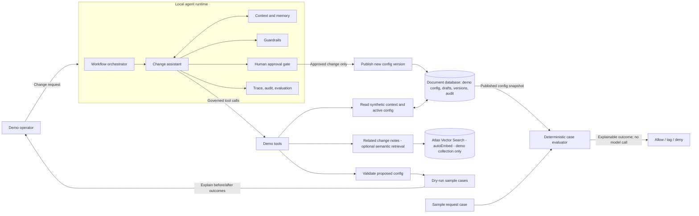

# Operational Change Assistant Demo (Atlas Agent Engine)

A self-contained, domain-neutral demonstration of an **operational change
lifecycle**, built on the Atlas Agent Engine local development stack.

> **Everything in this demo is fictional.** The workspace, services, tags,
> directives, notes, and configurations are synthetic fixtures invented for
> this walkthrough (`demo_workspace_001`, `demo_service_001`, ...). Nothing
> here represents any real organization's actual policies, data model,
> architecture implementation, or security controls, and none of the data
> describes real people or companies.

## The story (5–7 minute walkthrough)

The scenario: an operator asks an assistant to change the **operating
configuration** of a fictional workspace — a versioned set of directives that
determines whether synthetic `request`s to a `service` are allowed, allowed
with a routing tag, or denied.

This demo shows the *agent-authoring* half of that story — the part that
benefits from agentic flexibility — while keeping the live decision
deterministic:

```
Operator request (playground UI, http://localhost:3000)
  1. Agent retrieves synthetic context via explicit tools
     (workspace profile, services, active configuration, sample cases,
      related change notes via optional semantic retrieval)
  2. Agent drafts a structured configuration change (constrained demo DSL)
  3. Validation: schema, allowed operations/values, references,
     permitted lifecycle transitions (deterministic)
  4. Dry run: proposed vs. active configuration over sample cases
     (before/after table)
  5. Human approval: execution SUSPENDS (Agent Engine native interrupt)
     until a human approves or denies
  6. Only after approval: a new versioned configuration record is published,
     with a full audit trail
  7. Deterministic case evaluation (no LLM) against the active snapshot
```

**Where the agent runtime fits vs. the deterministic logic.** The Agent Engine
runtime provides the agent scaffold, tool sandboxing, LLM connection, workflow
state (checkpoints), and native human-in-the-loop suspend/resume. The
*decisioning* itself — validation, simulation, evaluation, and the publication
safeguard — is plain deterministic Python (`dsl.py`, `evaluator.py`,
`store.py`). Embeddings and semantic retrieval may help **find** context; they
never make or execute the operational decision. This demo is not a claim that
the document database is a complete rules engine, nor that the agent runtime
replaces an existing orchestration framework — it illustrates how agents can
help *author and govern* changes for such a system, and it makes no high-stakes
live decisions with an LLM.

## Architecture



Implemented in this demo: the change assistant, governed demo tools, DSL
validation, dry-run comparison, the human approval gate (native
suspend/resume), versioned publishing, the audit trail, and the deterministic
evaluator. Trace/evaluation surfaces come from the runtime's local dev stack;
no dedicated evaluation harness is implemented here.

## What Agent Engine contributes vs. what is ordinary code

| Capability | Provided by |
|---|---|
| Agent scaffold, LLM connection, tool sandboxing | Agent Engine runtime (`agent.yaml`, App SDK) |
| Workflow state / checkpoints (suspend–resume works) | Agent Engine runtime (`durable_workflow`, checkpointer) |
| Native human-in-the-loop pause/resume | Agent Engine `interrupt()` |
| Retrieving synthetic context (tools, optional semantic search) | Demo app code + Atlas |
| Validation, simulation, evaluation, approval gating, publishing | Deterministic demo code — no LLM |

## Prerequisites

- Docker Desktop running (for `agentengine dev up`)
- Agent Engine CLI (`agentengine`) on your `PATH` (see
  [Installing the Agent Engine CLI](#installing-the-agent-engine-cli) below)
- An LLM API key for the configured LLM client (set as `LLM_API_KEY`)
- Optional: an existing database cluster provisioned by
  [`../../atlas-cluster-provisioning/`](../../atlas-cluster-provisioning/)
  (this demo never creates, alters, or deletes a cluster)

### Installing the Agent Engine CLI

The `agentengine` CLI installs its binary into `~/.local/bin`. For the
installer for your platform, see the official Agent Engine installation docs.

**1. Verify the binary exists:**

```bash
~/.local/bin/agentengine version
```

**2. Add it to your `PATH` permanently.** `~/.local/bin` may not be on your
`PATH` by default. For zsh (the macOS default shell):

```bash
echo 'export PATH="$HOME/.local/bin:$PATH"' >> ~/.zshrc
source ~/.zshrc
```

Verify the CLI resolves:

```bash
agentengine version
```

(For bash, use `~/.bashrc` or `~/.bash_profile` in place of `~/.zshrc`.)

## Setup

```bash
cd agents/change-ops-agent
cp .env.example .env
# Edit .env:
#   LLM_API_KEY=<your key>
#   MONGODB_URI=          # leave EMPTY for mock mode, or point at an
#                         # existing cluster from atlas-cluster-provisioning
```

## Run

```bash
agentengine dev up
```

Then open the Playground UI at <http://localhost:3000>. Stop with
`agentengine dev stop`.

> **Troubleshooting:** `agentengine dev up` pulls runtime container images
> from the runtime's container registry. If the registry denies the pull, run
> `agentengine auth login` first (an authenticated session is required to
> fetch those images). Everything else in this demo — tests and deterministic
> case evaluation — runs without the stack.

**Modes**

- **Mock mode (default when `MONGODB_URI` is empty):** the demo store is
  in-memory; the log prints a clear `MOCK MODE` banner. Nothing is persisted.
  Deterministic case evaluation from the CLI works offline against the seeded
  baseline fixture configuration, and note retrieval uses the keyword
  fallback.
- **MongoDB mode:** set `MONGODB_URI` in `.env` to an existing cluster. The
  demo uses a dedicated database (`change_ops_demo` by default) and touches
  **only** its own collections (`change_drafts`, `config_versions`,
  `change_approvals`, `change_audit`, `demo_context`, `change_notes`).
  **Important:** by default `agentengine dev` runs its own local MongoDB
  container and overrides `MONGODB_URI`. To use your Atlas cluster in local
  dev, uncomment `mongodb: local: false` under `services` in `dev.yaml`, then
  run a full `agentengine dev stop && agentengine dev up` (a plain
  `dev restart` reuses previously generated artifacts and will keep pointing
  at the local container). Note the app's demo collections follow
  `MONGODB_URI`, while the runtime's checkpoint database follows
  `MDB_AGENTIC_STORE_DB`.

## Optional: semantic retrieval with Atlas Automated Embedding

Finding *related synthetic change notes* benefits from semantic retrieval.
This demo uses **Atlas Vector Search Automated Embedding**: the demo's Vector
Search index declares an `autoEmbed` field, so Atlas generates and manages
embeddings with a Voyage AI model (`voyage-4`) at index time and embeds the
plain-text query at query time. No client-side Voyage API key and no embedding
code are required for this path.

Scope and safety:

- One index (`change_notes_autoembed_index`) on ONE collection
  (`change_notes`) in the demo database only. `scripts/create_vector_index.py`
  is idempotent and refuses to run against non-Atlas URIs; it never modifies
  existing indexes or other resources.
- Automated Embedding is an **Atlas-only** feature; it does not work on the
  local MongoDB container. Without it, the `search_change_notes` tool falls
  back to deterministic keyword matching and reports which path it used.
- One-time setup (after `.env` points at an Atlas cluster):

```bash
PYTHONPATH=src python scripts/create_vector_index.py
```

- Index builds are asynchronous; allow 1–2 minutes before querying.
- Embeddings only *rank* context for the agent. The decision, validation, and
  evaluation paths remain deterministic and never consult embeddings.

If a prerequisite is missing (no URI, no index, driver/Atlas error), the tool
degrades to keyword fallback and says so — it does not silently fail.

## Example prompts (playground)

1. *"Show me the current operating configuration for demo_workspace_001 and
   the context behind it."* → agent calls `get_active_config`,
   `get_workspace_profile`, `list_services`, and cites sources.
2. *"Find any past change notes about the provisioning service in eu-demo-1."*
   → `search_change_notes` returns related synthetic notes (semantic retrieval
   when configured, keyword fallback otherwise).
3. *"Draft a change that allows standard requests to demo_service_002, and
   deny everything else unmatched."* → agent drafts DSL directives, submits
   via `submit_change_draft` (validation).
4. *"What would change?"* → `simulate_change` prints a before/after table for
   the four sample cases.
5. *"Submit it for approval."* → `request_change_approval` suspends the agent.
   Approve/deny in the playground's review prompt (the native interrupt).
6. After approving: *"Publish it."* → `publish_change` records version 2 and
   supersedes version 1. *"Show the audit trail."* → `show_audit_trail`.
7. *"Evaluate a standard request to demo_service_002 in eu-demo-1"* →
   `evaluate_case_tool` returns the deterministic outcome, matched directive,
   and config version (no LLM involved).

Expected guardrail behavior to show on camera:

- A draft with an unknown tag or service, or an invalid field, fails
  validation with named errors.
- Attempting to publish without approval returns an explicit refusal
  (`no recorded human approval`).
- A denied approval marks the draft rejected; it can never be published.
- Evaluation is repeatable: the same case always yields the same outcome.

## Deterministic case evaluation (no LLM)

Case evaluation is **deterministic**: it reads the active configuration
snapshot (`config_versions` where `status: "active"`) and never invokes a
model.

```bash
# Mock mode, seeded baseline configuration:
PYTHONPATH=src python -m agent_change_ops_agent.evaluate_cli

# One ad-hoc case against the active configuration on an existing cluster:
MONGODB_URI=... PYTHONPATH=src python -m agent_change_ops_agent.evaluate_cli \
  --service-id demo_service_002 \
  --request-type standard --region eu-demo-1
```

The database defaults resolve in this order: explicit `--database` flag >
exported `MONGODB_DATABASE` environment variable > `MONGODB_DATABASE` in
`.env` > the built-in default (`change_ops_demo`).

**Limitations to be upfront about:**

- `--service-id` only sets the *case input*. There is no per-workspace or
  per-tenant configuration selection in this demo; every evaluation uses the
  single active snapshot.
- The human approval step is a **demo workflow gate** (native suspend/resume
  with a recorded decision), **not** IAM-grade identity enforcement.

## Reset / re-seed

Synthetic fixtures (including baseline configuration version 1) re-seed
automatically when the store is empty. To wipe demo data in MongoDB and start
over (**destructive — drops only the demo collections listed above**):

```bash
PYTHONPATH=src python -m agent_change_ops_agent.reset_demo --yes
```

This drops **only** the demo collections in the demo database
(`change_ops_demo` by default). It never touches any other database,
collection, or cluster resource. In mock mode nothing is persisted, so there
is nothing to reset.

## Tests

```bash
PYTHONPATH=src python -m pytest tests -q
```

Covers: DSL validation (unknown actions/tags/services/match fields,
duplicates), permitted-transition matrix, approval gating (publish refuses
without an approved decision; denied drafts are dead ends; status shortcuts
cannot bypass the gate), versioning/supersede behavior, audit-trail ordering,
deterministic evaluation/dry-run diffs, keyword fallback retrieval, and
reset-collection scoping.

```bash
PYTHONPATH=src python -m ruff check src tests scripts
```

## What is mocked / honest limitations

- **Synthetic data everywhere** — fixtures in
  `src/agent_change_ops_agent/fixtures.py` are marked `demo: True` with
  fictional names; outputs repeat the caveat.
- **The DSL is a toy** — a constrained JSON directive structure with local
  validation, not a production rules engine and not any real organization's
  model.
- **Human approval** uses the runtime's native `interrupt()` suspend/resume
  (not an approximation) in the dev environment; there is no IAM-grade
  approval workflow around it, and the recorded approver name is
  self-reported by the reviewer in the playground.
- **Semantic retrieval is optional and Atlas-only** — Automated Embedding
  requires an Atlas cluster; on the local dev container the demo uses keyword
  fallback. Retrieval quality was not formally evaluated.
- **No deployment** — the demo is local (`agentengine dev`). It never
  provisions clusters, never makes external calls beyond the configured LLM
  egress, and never touches non-demo data.
- **No formal security review, production readiness, SLA, or identity
  guarantees** are claimed. Latency or coverage ambitions discussed in any
  particular engagement are rough POC ambitions, not commitments, and are out
  of scope for this code.
