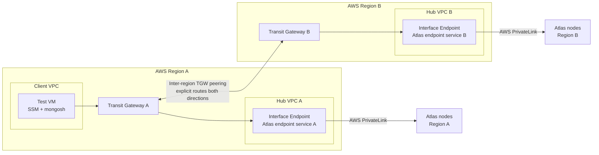
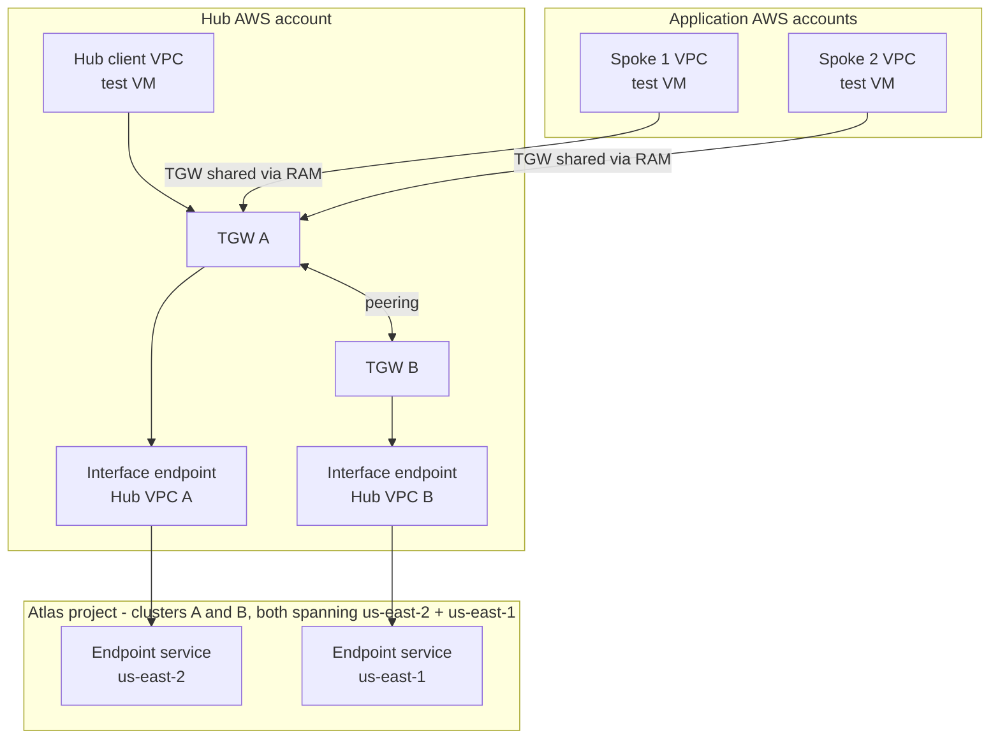

# atlas-privatelink-tgw-multiregion

A self-contained Terraform lab that proves one thing: a workload VM in **AWS region A** can query **both** the region-A and the region-B members of an **already-existing multi-region Atlas replica set**, entirely over AWS PrivateLink, with no public Atlas connectivity anywhere in the path.

The interesting part is the region-B path. A single interface endpoint only ever reaches the Atlas endpoint service in its own region, so the client VPC in region A gets to the region-B Atlas nodes through: region-A Transit Gateway → **inter-region Transit Gateway peering** → region-B Transit Gateway → region-B hub VPC → interface endpoint ENI → Atlas.



## What this does and does not manage

**Consolidation:** the two interface endpoints are the *only* PrivateLink endpoints in the estate. Every cluster in the Atlas project and every consuming AWS account shares them. Onboarding an application account adds a VPC, a Transit Gateway attachment, a security group CIDR and a route — and **zero** interface endpoints.

**Manages (AWS only):** two regional Transit Gateways and their route tables, one direct inter-region peering attachment with explicit static routes in both directions, a hub VPC per region holding the Atlas interface endpoints, a private client VPC in region A, and one test EC2 instance reached through SSM Session Manager.

**Does not manage:** anything in Atlas. The Atlas project, the multi-region cluster and the Atlas private endpoint service in each node region must already exist. No Atlas provider is configured, no Atlas API key is accepted, and no Atlas connection string is ever read — so none of them can end up in this Terraform state.

**Atlas is not a network peer.** It is not a Transit Gateway attachment and not a VPC peering. The hub VPC's interface endpoint is the single attachment point to the Atlas PrivateLink endpoint service; everything else here exists only to deliver packets to those ENIs.

## The packet walk

| Step | What carries it | Declared in |
|---|---|---|
| VM → region-A hub prefix | client VPC route table, explicit `/16` per hub → TGW A | `terraform/modules/client-vpc/main.tf`, `aws_route.to_hubs` |
| Application account VM → TGW A | same module, same routes, across an account boundary on a RAM-shared gateway the hub accepted explicitly | `terraform/main.tf`, `..._vpc_attachment_accepter.spoke_1` |
| TGW A → hub A | VPC attachment, route propagated into the lab's TGW route table | `terraform/main.tf`, `..._route_table_propagation.hub_a` |
| TGW A → region B | static route: remote hub prefix → peering attachment | `terraform/main.tf`, `..._transit_gateway_route.a_to_remote_hubs` |
| TGW B → hub B | VPC attachment, propagated | `terraform/main.tf`, `..._route_table_propagation.hub_b` |
| hub → Atlas | interface endpoint to the Atlas endpoint service | `terraform/modules/hub-vpc/main.tf`, `aws_vpc_endpoint.atlas` |
| replies, region B → VM | static route: client prefix → peering attachment, plus a hub route table entry for the client prefix | `terraform/main.tf`, `..._transit_gateway_route.b_to_client` |

Every Atlas-bound destination is an explicit prefix. There is deliberately no `0.0.0.0/0` route pointing at a Transit Gateway.

## Prerequisites

- An Atlas project with a **multi-region replica set that already has nodes in both AWS regions** you intend to use, and **at least two electable nodes in the primary's region** — the per-region query test reads from a secondary in each region.
- An **Atlas private endpoint service in every one of those node regions** (Atlas UI → Network Access → Private Endpoint → Dedicated cluster → AWS). You need its endpoint service name, which looks like `com.amazonaws.vpce.eu-west-1.vpce-svc-0123456789abcdef0`. That name is an identifier, not a secret.
- A **database user** with `readWrite` on the test database (default `atlas_plink_demo`) and `clusterMonitor`, or simply `atlasAdmin`. `clusterMonitor` is what lets the test read `rs.conf()`, which is where Atlas records each member's region.
- A **hub AWS account** with permission to create VPCs, Transit Gateways, Transit Gateway peering, VPC endpoints, EC2, NAT gateways, IAM roles and RAM shares in both regions.
- *Optional, for the multi-account demo:* one or two **application AWS accounts** in the same AWS Organization, each with a role Terraform can assume (`OrganizationAccountAccessRole` by default), and RAM organisation sharing enabled once in the management account. See [Multiple application accounts](#multiple-application-accounts-one-pair-of-endpoints). Leave `SPOKES='{}'` for the single-account lab.
- `terraform` ≥ 1.5, `aws` CLI v2, `jq`, and the **Session Manager plugin**. The plugin is a separate binary from the AWS CLI, and `aws ssm start-session` fails with `SessionManagerPlugin is not found` without it:

  ```bash
  brew install --cask session-manager-plugin     # macOS
  # or the official bundle:
  # https://docs.aws.amazon.com/systems-manager/latest/userguide/session-manager-working-with-install-plugin.html
  session-manager-plugin --version               # verify
  ```

  The non-interactive tests below work without it.
- AWS credentials from a named profile or an SSO session. Never put access keys in `.env`.

One Atlas project-region endpoint service serves **every cluster in that Atlas project and region**. It cannot serve a different Atlas project. You only need a second interface endpoint in a hub if you are reaching a second Atlas project in the same region.

## Layout

```
atlas-privatelink-tgw-multiregion/
  README.md
  .env.example       copy to .env; no secrets belong in it
  deploy.sh          .env -> TF_VAR_*, preflight checks, cost summary, apply
  teardown.sh        confirmed destroy with the documented prevent_destroy override
  terraform/
    main.tf            regions wired together: modules, TGW route tables, peering, routes
    providers.tf       one aliased AWS provider per region, mandatory tags via default_tags
    variables.tf       inputs, keyed by region key, with per-variable validation
    locals.tf          tags, ASNs, CIDR inventory, overlap detection, test targets
    validation.tf      cross-variable preconditions, evaluated before any AWS call
    outputs.tf         IDs, endpoint DNS names, ready-made Session Manager commands
    modules/
      transit-gateway/ regional TGW and its explicit route table
      hub-vpc/         hub VPC, endpoint subnets, endpoint SG, Atlas interface endpoints
      client-vpc/      private VPC, SSM endpoints, optional NAT egress, IAM role,
                       test VM, and the scripts it runs (templates/, files/).
                       Used three times over: once for the hub account's own
                       client VPC and once per application account, the only
                       differences being the provider it is given, a name
                       suffix, and tgw_cross_account for the RAM-shared gateway
```

Both scripts drive Terraform with `-chdir=terraform`, so run them from this folder. To drive Terraform directly, either `cd terraform` or use `terraform -chdir=terraform …`.

All resources are named `<NAME_PREFIX>-<role>-<region key>`, or `<NAME_PREFIX>-spoke-<n>-<role>-<region key>` in an application account, and tagged `Project`, `Environment`, `Owner`, `Purpose` and `ManagedBy=Terraform` in every account.

## Multiple application accounts, one pair of endpoints

Set `SPOKES` in `.env` and each named AWS account gets a VPC, a Transit Gateway attachment and a test VM — while the interface endpoint count stays at two.



### Why no Route 53 work is needed

Centralised interface endpoints normally force private hosted zone sharing across accounts. Not here, and the reason is the `private_dns_enabled = false` rule this lab has enforced from the start: Atlas keeps ownership of the hostnames, and the records it publishes in `mongodb.net` are **public DNS entries pointing at the endpoints' private addresses**. Any VPC in any account resolves them correctly with no zone sharing and no resolver rules.

The SSM endpoints in each spoke VPC are the counter-example — they use private DNS, cannot be shared the same way, and so each spoke builds its own three. That contrast is worth showing.

### What onboarding an application account costs

| Added per account | Not added per account |
|---|---|
| VPC, subnets, route table | Interface endpoint |
| TGW attachment (+ hourly charge) | Endpoint ENIs |
| One security group CIDR rule per hub | Atlas registration |
| One TGW route table association + propagation | Atlas endpoint service |
| One static route in region B, over the peering | Route 53 anything |

### Checking what you have

```bash
./scripts/org-report.sh            # or: ./scripts/org-report.sh <aws-profile>
```

Prints the organization, which account you are in, and — the part that matters — whether each member account's `OrganizationAccountAccessRole` is actually assumable from here:

```
organization : o-xxxxxxxxx
management   : ...0015
you are in   : ...0015 (the management account)

ACCOUNT                ID       JOINED    USABLE AS A SPOKE?
app-account-1          ...4242  CREATED   YES - OrganizationAccountAccessRole assumable
some-other-account     ...8013  INVITED   no - cannot assume OrganizationAccountAccessRole
```

Two traps it catches:

- **IAM users are not AWS accounts.** Several profiles in `~/.aws/credentials` often authenticate into the *same* account. A spoke must be a distinct AWS account; the account boundary is what this lab crosses.
- **Invited accounts have no `OrganizationAccountAccessRole`.** Only accounts *created* through Organizations get it automatically. For an invited account, create the role by hand with a trust policy naming the hub account, or create a fresh member account:

  ```bash
  aws organizations create-account --email you+app1@example.com --account-name "app-1"
  aws organizations list-create-account-status \
    --query 'CreateAccountStatuses[].{Name:AccountName,State:State,Id:AccountId}' --output table
  ```

### Creating the application accounts

A spoke must be a distinct **AWS account**. Several profiles in `~/.aws/credentials` often authenticate into the *same* account as different IAM users — that is not a spoke, because the boundary this lab crosses is the account, not the identity.

Accounts **created** through Organizations get `OrganizationAccountAccessRole` automatically, with a trust policy naming the management account. Accounts **invited** into an organisation do not, and cannot be used until you create an equivalent role by hand.

```bash
# from the organisation's management account
aws organizations create-account \
  --email you+app1@example.com --account-name "app-1"
aws organizations create-account \
  --email you+app2@example.com --account-name "app-2"

# poll until State=SUCCEEDED, then note the AccountId
aws organizations list-create-account-status \
  --query 'CreateAccountStatuses[].{Name:AccountName,State:State,Id:AccountId,Reason:FailureReason}' \
  --output table

./scripts/org-report.sh        # expect YES against each new account
```

Each email must be globally unique across all of AWS and must remain reachable — it becomes the account's root user address, needed later to close the account. Plus-addressing (`you+tag@yourdomain`) is the simplest way to get unique addresses that land in one inbox, if your mail provider supports it.

Named an account wrongly? Rename it rather than deleting it — closing an AWS account starts a 90-day suspension during which the email cannot be reused:

```bash
aws organizations enable-aws-service-access --service-principal account.amazonaws.com
aws account put-account-name --account-id <account-id> --account-name "app-2"
```

Then put the account IDs into `SPOKES` in `.env`. `deploy.sh` verifies each role is assumable before Terraform creates anything.

### Prerequisites for spokes

- The application accounts are in the **same AWS Organization** as the hub, and the management account has run once:

  ```bash
  aws ram enable-sharing-with-aws-organization
  ```

  Otherwise set `RAM_ALLOW_EXTERNAL_PRINCIPALS=true` and accept the share manually in each account.
- Terraform can assume `role_arn` in each account — `OrganizationAccountAccessRole` by default in an Organization.
- Non-overlapping CIDRs across every account. Terraform validates every prefix in the lab against every other, including spokes.

Cross-account attachments are **not** auto-accepted: `auto_accept_shared_attachments` stays `disable` on both gateways and the hub account accepts each attachment explicitly, so the hub decides what may route where.

### Honest trade-off versus an endpoint per account

Centralising saves ENI-hours but routes every query through the Transit Gateway, which bills **per GB in each direction**. An endpoint per account inverts that: more ENI-hours, no TGW data processing for Atlas traffic. There is a break-even in GB/month per application — compute it with real volumes rather than assuming the hub wins. The hub model also makes those ENIs a shared bottleneck and a shared failure domain, which is the argument for more AZs per hub, and it concentrates blast radius in one team's change window.

Consolidation also stops at the **Atlas project boundary**. A second Atlas project needs its own endpoint service and its own interface endpoint — add it as a second entry in that hub's `atlas_endpoint_services` map, in the same hub VPC.

## Two clusters through the same endpoints

Two clusters in the same Atlas project and regions share the endpoint services. Each gets its own `-pl-N` SRV hostname and its own **port block** on the same ENIs. Prove it in one command:

```bash
sudo atlas-plink-test \
  --srv cluster-a-pl-0.xxxxx.mongodb.net \
  --srv cluster-b-pl-0.xxxxx.mongodb.net
```

```
== cluster-a-pl-0.xxxxx.mongodb.net ==
  ...shard-00-00...:1044   10.20.1.220   open   hub a/us-east-2 [same-region]
  ...shard-00-02...:1046   10.30.1.149   open   hub b/us-east-1 [cross-region]
== cluster-b-pl-0.xxxxx.mongodb.net ==
  ...shard-00-00...:1047   10.20.1.220   open   hub a/us-east-2 [same-region]
  ...shard-00-02...:1049   10.30.1.149   open   hub b/us-east-1 [cross-region]

== 6 of 6 Atlas nodes reachable ==
== 2 cluster(s) reached through 2 endpoint address(es): 10.20.1.220 10.30.1.149 ==
```

Same addresses, different ports. Run the identical command from a spoke account's VM and the addresses do not change — that is the consolidation, demonstrated rather than asserted.

Creating the second cluster: `atlas-cluster-provisioning/` holds a single `mongodbatlas_advanced_cluster.demo` in local state, so re-running it with a new `CLUSTER_NAME` **replaces** the existing cluster. Use `terraform workspace new cluster-b`, or copy the folder.

## Cost warning

**This lab costs real money for as long as it exists, and most of it is charged per hour regardless of traffic.**

Running with the defaults (two regions, two AZs per hub, one Atlas endpoint service per region, NAT egress on):

| Resource | Count | Charged |
|---|---|---|
| Transit Gateway | 2 | per gateway-hour |
| Transit Gateway attachment (VPC) | 3 | per attachment-hour |
| Transit Gateway attachment (peering) | 1 | per attachment-hour, both sides |
| Atlas interface endpoint ENI | 4 | per ENI-hour |
| SSM interface endpoint ENI | 6 | per ENI-hour |
| NAT gateway + elastic IP | 1 | per hour and per GB; removable, see below |
| EC2 test instance | 1 per account | per instance-hour |
| Spoke TGW attachment + SSM endpoints | per application account | per attachment-hour, per ENI-hour |
| Transit Gateway data processing | — | per GB |
| Inter-region data transfer | — | per GB |

Rates vary by region; check the current AWS pricing pages. Run `./teardown.sh` as soon as you are done — this is a disposable lab, not a reference deployment you leave running.

## Internet egress, and why the PrivateLink claim still holds

The test VM needs `mongosh`, and `mongosh` comes from `repo.mongodb.org`. So the client VPC is built with an internet gateway, a `/28` NAT subnet and a NAT gateway, and the private subnets get a `0.0.0.0/0` route to it. That is the default (`CLIENT_INTERNET_EGRESS=true`).

That egress path cannot become an Atlas path, for four independent reasons:

1. **The security group.** The VM may send TCP **1024–65535 only to the hub VPC CIDRs**. Towards `0.0.0.0/0` it may send **80 and 443, and nothing else**. Atlas serves the MongoDB wire protocol on 27017 and on the 1024+ private-endpoint ports — none of which are permitted towards the internet.
2. **Longest prefix wins.** Each hub `/16` has a specific route to the Transit Gateway. The default route to the NAT gateway is never a candidate for Atlas traffic.
3. **DNS.** The private-endpoint connection string resolves, via Atlas's own CNAMEs, to the interface endpoints' private addresses inside the hub VPCs. Nothing in the path resolves to a public Atlas address.
4. **The VM has no public IP**, no key pair and no inbound rule of any kind. The NAT gateway's elastic IP is the only public address in the lab, and it is outbound-only.

Verify it on the VM:

```bash
atlas-plink-egress-check
```

It shows that HTTPS to the internet works, that TCP 27017 to a public host is blocked, what the default route is, and that the instance has no public IPv4 address.

**Strictest posture:** once `mongosh` is installed, turn the egress off and re-apply. The NAT gateway, its elastic IP and the default route are deleted; `mongosh` and the whole Atlas path keep working, and the instance is not replaced.

```bash
CLIENT_INTERNET_EGRESS=false ./deploy.sh
```

Each application account gets its own NAT gateway on the same terms, controlled by `internet_egress_enabled` inside that spoke's `SPOKES` entry — so you can leave the hub VM with egress for convenience and run the application VMs with none, which is the more realistic posture.

If you would rather never have a NAT gateway at all, stage a `mongosh` tarball in a bucket you control, set `MONGOSH_S3_URI` and deploy with `CLIENT_INTERNET_EGRESS=false` from the start. It is fetched over the S3 gateway endpoint, and the instance role is scoped to that single object.

## Configure

```bash
cd atlas-privatelink-tgw-multiregion
cp .env.example .env
$EDITOR .env
```

`.env` is git-ignored and must contain no Atlas URI, no Atlas API key, no database password and no AWS access key. `deploy.sh` refuses to run if it finds any of them.

The two values you have to supply yourself are `TAG_OWNER` and the real Atlas endpoint service names inside `HUBS`. Everything else has a working default, including `SPOKES='{}'` — leave that alone for the single-account lab, or fill it in for the multi-account demo.

### CIDRs

Terraform validates the address plan before it calls AWS: VPC CIDRs must be `/16`–`/28`, no two VPCs in the lab may overlap, every subnet — including the NAT subnet — must sit inside its own VPC, and subnets within a VPC may not overlap each other. Overlapping prefixes are the most common way a Transit Gateway lab silently half-works, so this fails the plan rather than the demo.

### Availability and cost trade-off

`subnet_cidrs` controls how many Availability Zones an interface endpoint spreads over — **one ENI per subnet, each billed per hour**. Two or more is the supported shape here and the default: a single-AZ endpoint makes that one AZ a single point of failure for the entire region's Atlas path, which is a strange thing to demonstrate in a lab about resilient multi-region connectivity. If a region or an endpoint service genuinely offers only one AZ, set `ALLOW_SINGLE_AZ_ENDPOINTS=true` to accept that deliberately.

## Deployment sequence

Atlas sits in the middle of this, so it is not a single `apply`.

1. **Build the AWS side.**

   ```bash
   ./deploy.sh
   ```

   The interface endpoints come up in `pendingAcceptance`. That is expected: the Atlas endpoint service has not been told about them yet. `mongosh` installs on each VM at boot.

   With `SPOKES` set, this single apply also builds the application accounts: it shares the region-A Transit Gateway through RAM, creates each spoke VPC and VM by assuming the role you named, accepts each attachment back in the hub account, and adds the routes and security group entries for every spoke CIDR. One apply, three accounts.

2. **Hand each endpoint ID to Atlas.**

   ```bash
   terraform -chdir=terraform output atlas_interface_endpoints
   ```

   In Atlas → Network Access → Private Endpoint, open the private endpoint for each region and give it the matching `vpce-…` ID from that region. Atlas accepts the connection and the endpoint moves to `available`. Wait for Atlas to report the endpoint as `AVAILABLE` in **both** regions before testing.

3. **Get the private-endpoint-aware connection string** from Atlas → Connect → Private Endpoint. It is a different SRV hostname from the public one, and it is the only string that resolves to these endpoints. Keep it out of this repository.

4. **Test.** See below — from the hub VM, and from each application account's VM.

   ```bash
   terraform -chdir=terraform output privatelink_footprint
   ```

   ```
   atlas_endpoint_services   = 2
   interface_endpoints       = 2
   endpoint_enis             = 4
   consuming_aws_accounts    = 3
   endpoints_per_new_account = 0
   ```

## Test procedure

Open a shell on the test VM. No SSH key, no bastion, no public IP:

```bash
eval "$(terraform -chdir=terraform output -raw start_session_command)"
```

Before that works, confirm the VM has registered with Session Manager — this also proves the SSM interface endpoints are doing their job from a VPC with no public addressing:

```bash
aws ssm describe-instance-information --region <region A> \
  --filters "Key=InstanceIds,Values=$(terraform -chdir=terraform output -raw test_instance_id)" \
  --query 'InstanceInformationList[].{Ping:PingStatus,Agent:AgentVersion}' --output table
```

`PingStatus: Online` means the VM is ready. If `start-session` then fails with `SessionManagerPlugin is not found`, that is a missing local binary, not a problem with the lab — see Prerequisites.

### From an application account's VM

```bash
terraform -chdir=terraform output spokes
```

Each entry carries the account ID, the instance ID and a ready-made `start_session_command`. Those instances live in **another AWS account**, and `aws ssm start-session` has no `assume_role` of its own, so it needs credentials for that account.

**You do not need to create IAM users in the application accounts.** Add a role profile per account to `~/.aws/config` — nothing goes in `~/.aws/credentials`, and the CLI assumes the role for you exactly as Terraform does:

```bash
aws configure set profile.app-1.role_arn       arn:aws:iam::<app-1-account-id>:role/OrganizationAccountAccessRole
aws configure set profile.app-1.source_profile <your-hub-profile>
aws configure set profile.app-1.region         <region A>
```

which writes:

```ini
[profile app-1]
role_arn       = arn:aws:iam::<app-1-account-id>:role/OrganizationAccountAccessRole
source_profile = <your-hub-profile>
region         = <region A>
```

Then:

```bash
AWS_PROFILE=app-1 aws ssm start-session --region <region A> --target <spoke instance id>
```

For a one-off without editing any config, export temporary credentials instead:

```bash
eval $(aws sts assume-role --profile <your-hub-profile> \
  --role-arn arn:aws:iam::<app-1-account-id>:role/OrganizationAccountAccessRole \
  --role-session-name ssm --query Credentials --output text |
  awk '{print "export AWS_ACCESS_KEY_ID="$1" AWS_SECRET_ACCESS_KEY="$3" AWS_SESSION_TOKEN="$4}')
```

If you take that route, make sure `AWS_PROFILE` is **unset** in that shell. With both set, the CLI tries to resolve the profile name and fails with `The config profile () could not be found`.

Confirm the VM is reachable before opening a session:

```bash
AWS_PROFILE=app-1 aws ssm describe-instance-information --region <region A> \
  --filters "Key=InstanceIds,Values=<spoke instance id>" \
  --query 'InstanceInformationList[0].{Ping:PingStatus,Agent:AgentVersion}' --output json
```

Then run the identical tests you ran on the hub VM. **The point is that nothing changes**: the same endpoint addresses, the same ports, the same Atlas nodes — reached from an account that owns no PrivateLink endpoint and is registered with Atlas nowhere.

```bash
sudo atlas-plink-test --srv <cluster-a>-pl-0.xxxxx.mongodb.net --srv <cluster-b>-pl-0.xxxxx.mongodb.net
atlas-plink-query
```

Running `atlas-plink-test` on the hub VM and on both spoke VMs and diffing the three outputs is the single most convincing artefact this lab produces: three accounts, one pair of endpoints, byte-identical results.

### Running the tests without the Session Manager plugin

`atlas-plink-test` and `atlas-plink-egress-check` take no input, so they can be run with `send-command` and the output collected afterwards:

```bash
REGION=<region A>
ID=$(aws ssm send-command --region "$REGION" \
  --instance-ids "$(terraform -chdir=terraform output -raw test_instance_id)" \
  --document-name AWS-RunShellScript \
  --parameters 'commands=["/usr/local/bin/atlas-plink-test"]' \
  --query 'Command.CommandId' --output text)

sleep 20
aws ssm get-command-invocation --region "$REGION" \
  --command-id "$ID" \
  --instance-id "$(terraform -chdir=terraform output -raw test_instance_id)" \
  --query 'StandardOutputContent' --output text
```

`atlas-plink-query` prompts for the connection string and password, so it needs a real interactive session and therefore the plugin.

### 1. TCP reachability, both regions

The reliable form reads the real ports out of DNS, exactly as the driver does:

```bash
sudo atlas-plink-test --srv <cluster>-pl-0.xxxxx.mongodb.net
```

Paste the whole private-endpoint connection string if it's easier — the scheme, any credentials, a port, a trailing path and a query string are all stripped before the lookup. It resolves `_mongodb._tcp.<hostname>`, opens a TCP connection to every `host:port` Atlas published, and reports which hub and region each node was reached through:

```
atlas-xxxxx-shard-00-00.yyyyy.mongodb.net:1044   10.20.1.220   open   hub a/us-east-2 [same-region]
atlas-xxxxx-shard-00-02.yyyyy.mongodb.net:1046   10.30.1.149   open   hub b/us-east-1 [cross-region]
```

That last column is the lab's claim in one line. All nodes reachable means exit 0. The hostname must contain `-pl-N`; the standard connection string will not resolve to your endpoints.

Without `--srv` it falls back to scanning a port range:

```bash
sudo atlas-plink-test            # scans TEST_PORT_SCAN, default 1024-1060
sudo atlas-plink-test 1045       # or name ports explicitly
```

**Atlas port numbers are not predictable.** Atlas allocates a block per private endpoint starting at 1024, but which block depends on how many clusters and endpoints the project already holds — a cluster commonly lands on 1045 or higher. A range scan that finds nothing is therefore *not* evidence of a routing fault; re-run with `--srv` before concluding anything. Probes run 32-way parallel, so the range costs seconds.

Success looks like at least one open port on the `same-region` hub **and** on the `cross-region` hub.

### 2. Explicit per-region queries — the real proof

```bash
atlas-plink-query
```

This is the test that answers "did I actually read from a node in each region?". A connection string alone proves nothing: the driver would happily serve every read from the nearest node. So the script pins each read to a named node using Atlas's own member tags, and then reads the serving host back out of the server's explain output.

What it does, in order:

1. Reads `rs.conf()` and `rs.status()` and prints every member with its state, provider and **region** — Atlas tags each member with the region it runs in.
2. Identifies the primary's region, then picks two targets: **the secondary in the primary's region**, and **a secondary in the other region**.
3. Writes one probe document through the primary with `w: "majority"`, so both secondaries have it durably.
4. For each target, sets `readPreference: secondary` with `tags: [{ region: <that region> }]`, runs `find({_id: <this run>})`, and reports:
   - which host served it, taken from `explain().serverInfo.host`
   - whether that host is in the region that was asked for, and is not the primary
   - the document count and execution time

A target only passes if the read was served by a **secondary**, in the **requested region**, and returned the probe document. Both rows must be `PASS`:

```
Summary
--------------------------------------------------------------------
  PASS  EU_WEST_1     served by cluster0-shard-00-01.xxxxx.mongodb.net:1025
  PASS  EU_CENTRAL_1  served by cluster0-shard-00-02.xxxxx.mongodb.net:1024
```

The second row is the one that matters: that read left the VM, crossed the inter-region Transit Gateway peering, entered the region-B hub VPC, and reached Atlas through the region-B interface endpoint.

Credential handling: the SRV URI is read with echo off, any `user:password@` you paste with it is stripped before `mongosh` ever sees it, and `mongosh` prompts for the password itself. Nothing is written to disk, shell history, process arguments or Terraform state.

Use a different namespace by exporting `ATLAS_PLINK_DB` and `ATLAS_PLINK_COLL` before running it.

### 3. Egress posture

```bash
atlas-plink-egress-check atlas-xxxxx-shard-00-00.yyyyy.mongodb.net
```

Pass one of your cluster's real node hostnames — the `atlas-…-shard-00-00` name printed by `atlas-plink-query`. That host definitely listens on 27017 over the internet, so `blocked` can only be this VM's egress rules, which is the strong form of the proof. With no argument it probes `mongodb.net`, which may not listen on 27017 at all and is therefore weak evidence.

It also prints the default route and confirms the instance has no public IPv4 address. Exit code is non-zero if any probe contradicts the design.

### Negative tests worth doing live

- Remove the `b_to_client` static route: the cross-region query starts failing while the same-region one keeps working — a five-second demonstration that peering routes are needed in both directions.
- `curl -v telnet://<a-public-atlas-host>:27017` from the VM hangs and times out, while `atlas-plink-query` succeeds.

## Known limits

- **Transit Gateway peering is not transitive.** A packet arriving on a peering attachment is never forwarded out of another peering attachment. With two regions that never shows up. With three it does — see below.
- **One Atlas endpoint service per Atlas project and region.** It serves every cluster in that project and region, and it cannot serve a different Atlas project. A second Atlas project in the same region needs its own endpoint service and its own interface endpoint.
- **`private_dns_enabled` stays `false` on the Atlas endpoints** and must not be turned on. Atlas owns the private-endpoint-aware hostnames: the SRV record and the per-node CNAMEs in `mongodb.net` point at the endpoint's generated DNS names and encode which port belongs to which node. Enabling private DNS on the AWS side hijacks that resolution and breaks the mapping.
- **Security groups cannot be referenced across regions.** The region-B endpoint security group therefore authorises the region-A client by CIDR, not by group. Keep the client CIDR list as tight as the lab allows; it is the only thing between that prefix and the Atlas endpoint.
- **The endpoint security group opens TCP 1024–65535** from the client CIDRs, because that is the range Atlas allocates node ports from on a private endpoint.
- **The NAT gateway holds the only public IP in the lab**, and exists only so `mongosh` can be installed. It is outbound-only, it cannot carry MongoDB traffic, and `CLIENT_INTERNET_EGRESS=false` removes it.
- **The per-region query test depends on Atlas member tags.** Atlas sets `provider` and `region` on every member; a self-managed replica set would need those tags added by hand before the test could target regions.
- **Spokes are capped at two and live in region A.** Provider configurations cannot be generated dynamically, so `SPOKES` accepts the keys `"1"` and `"2"`, each wired to a static aliased provider. A third application account is a copy-paste of one provider block and one module block — see below. All spokes attach to the region-A gateway and reach region B over the existing peering.
- **Spoke SSM endpoints are not shared.** They use private DNS, so unlike the Atlas endpoints they cannot be consumed across accounts without Route 53 private hosted zone sharing. Each spoke therefore builds its own three interface endpoints, at its own hourly cost. This is the contrast that shows why the Atlas case is unusually clean.
- **Cross-account attachments are accepted explicitly.** `auto_accept_shared_attachments` stays `disable`, so an application account can create an attachment but cannot route anywhere until the hub account accepts it and associates it with the lab's route table.
- **One Terraform state spans every account.** A single apply reaches into the application accounts by assuming a role. That is convenient for a lab and questionable for production, where each account would typically own its own state and pipeline.
- **The client VPC is region A by construction.** Terraform cannot generate provider configurations dynamically, so the client-vpc module is wired to the `aws.region_a` alias. `client.region_key` is explicit rather than implied so the wiring is readable, but it has to be `"a"`.
- **State is local**, following this repository's convention for disposable labs. It holds no Atlas or AWS secrets, but it is still git-ignored; use a remote backend if more than one person will run this.
- **Atlas-side cleanup is manual.** Terraform does not manage the Atlas private endpoints and cannot delete them.

## Adding a third region

The variables, modules and validation are all keyed by region key, so a third region is additive rather than a redesign:

1. Add a `"c"` entry to `HUBS` in `.env` with a non-overlapping VPC CIDR and the Atlas endpoint service name for that region.
2. Uncomment the `aws.region_c` provider in `terraform/providers.tf`.
3. Uncomment the `module "tgw_c"` / `module "hub_c"` blocks at the bottom of `terraform/main.tf`, add the route table association and propagation pair for `hub_c`, and add `"c"` to `local.hub_modules`.
4. **Add a direct peering attachment from A to C** — and from B to C if those two regions ever need to talk — each with its static routes declared in both directions.

Application accounts need no change for a third region: they attach to region A and inherit the new hub prefix through `local.hub_cidr_blocks`, which becomes a route and a security group entry automatically.

Step 4 is not optional and not a shortcut you can skip. Because peering is not transitive, `A → B → C` does not work: traffic from A will not be forwarded through B's gateway onto B's peering with C. Either build a full mesh of direct peerings, or move to an explicitly supported design such as a Cloud WAN core network. Anything else looks correct in the console and drops packets.

## Adding another application account

Two are wired up. A third is additive, the same shape as adding a region:

1. Add a `"3"` entry to `SPOKES` with its account ID, role ARN and non-overlapping CIDRs.
2. Copy the `aws.spoke_2` provider block in `terraform/providers.tf` to `aws.spoke_3`, changing the key it reads.
3. Copy the `module "spoke_2"` block plus its three companions — the attachment accepter, the route table association and the propagation — changing `"2"` to `"3"` throughout.
4. Relax the `spokes` variable validation to accept the key `"3"`.

No new interface endpoint, no Atlas change, and nothing to do in region B beyond the static route Terraform adds for you from `local.client_cidr_blocks`. That is the whole point of the design: the marginal cost of an application account is a VPC and an attachment, not a PrivateLink endpoint.

## Cleanup

The Transit Gateways, the peering attachment, the interface endpoints and every VPC — hub, client and spoke — carry `lifecycle { prevent_destroy = true }`. A stray `terraform destroy` fails on them by design. Spoke VPCs are covered by the same guard because they are instances of the same `client-vpc` module, and an override file applies to every instance of the module it sits in.

The deliberate override is the teardown script:

```bash
./teardown.sh
```

It asks you to type the name prefix, writes `zz_destroy_override.tf` files under `terraform/` that set `prevent_destroy = false` — Terraform merges `lifecycle` arguments from an override file one by one, so nothing else is changed — runs the destroy, then removes those files on exit whether the run succeeded, failed or was interrupted. `*_override.tf` is git-ignored so the guard rails can never be disabled in a commit.

Non-interactive, for a CI runner or a cleanup job:

```bash
ALLOW_DESTROY=yes ./teardown.sh
```

To override one specific resource by hand instead, `terraform state rm` it or write your own `*_override.tf` — the same mechanism, done consciously.

**With spokes, teardown reaches into the application accounts** using the same assumed roles, and destroys their VPCs, VMs, SSM endpoints and attachments as well as the hub. Terraform removes the attachments before the RAM share, so the ordering is handled for you. If a role has since been revoked, the destroy will fail part-way: restore the role, or remove that spoke from `SPOKES` and delete its resources in that account by hand.

To decommission one application account and leave the rest running, drop its entry from `SPOKES` and re-run `./deploy.sh` — but note that removing a protected VPC still trips `prevent_destroy`, so use `./teardown.sh` semantics or a targeted override for that module.

**Then delete the Atlas private endpoints** for these regions in Atlas. Terraform does not manage them, and once the interface endpoints are gone they point at nothing.
