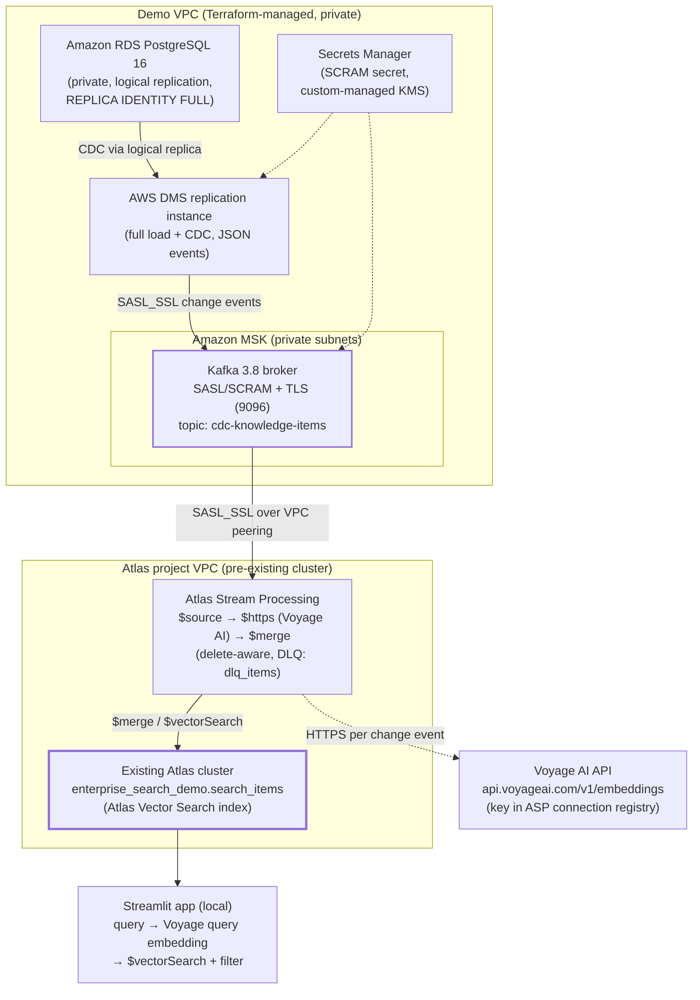

# PostgreSQL → CDC → Atlas Vector Search (read model) Demo

An anonymized, art-of-the-possible demo of a **continuously updated MongoDB search read model** sourced from PostgreSQL:



Everything on the AWS side is Terraform-managed and AWS-managed: **no ECS, no custom containers, no hand-built services**. The Atlas cluster is **pre-existing** (provisioned separately via `../atlas-cluster-provisioning/`) and is never created, replaced, or destroyed here.

## What the demo shows

1. Insert/update/delete synthetic rows in PostgreSQL.
2. AWS DMS captures them via logical replication and publishes JSON change events to a private Amazon MSK topic.
3. An Atlas Stream Processing processor consumes the topic, embeds the searchable text with **Voyage AI** over secure HTTPS (key stored in the Atlas connection registry, never in the pipeline file), and merges into a delete-aware read model keyed by the PostgreSQL primary key.
4. A local Streamlit app runs semantic search with an optional entity-type filter over the read model.

## Verified design decisions (from official docs)

| Decision | Why |
|---|---|
| DMS → MSK with **SASL/SSL (SCRAM-SHA-512)** | DMS Kafka targets do **not** support IAM access control for MSK; SASL-SSL with SCRAM-SHA-512 is the supported option (AWS DMS user guide, *Using Apache Kafka as a target*). |
| Kafka 3.8.x on MSK | New MSK standard-tier clusters only offer 3.8.x+; AWS DMS supports SASL/SCRAM up to Kafka 3.8, so 3.8.x is the newest compatible version. |
| MSK stays **fully private** | MSK SASL/SCRAM clusters cannot be exposed publicly, so both DMS and Atlas Stream Processing connect over private networking (VPC peering). |
| ASP Kafka connection via **VPC peering**, `SASL_SSL` + `SCRAM-SHA-512` | Atlas Stream Processing supports Kafka connections with Public IP or VPC Peering network access; `SASL_SSL` + SCRAM mechanisms are supported (Atlas docs, *Add a Kafka Connection*). |
| Embeddings via the ASP **`$https`** stage to Voyage AI | ASP HTTPS connections are defined in the connection registry with auth headers — the API key lives in Atlas, not in the pipeline artifact. `onError: "dlq"` routes failures to the dead letter queue. |
| Deletes via `$merge.whenMatched` dynamic `"delete"` | ASP `$merge` supports a dynamic `whenMatched` expression resolving to `"delete" | "replace"` — used to propagate PostgreSQL deletes (documented pattern in the ASP `$merge` page). |
| `voyage-3.5`, 1024 dimensions (256/512/1024/2048 supported) | Per the Voyage AI embeddings API. `VOYAGE_DIMENSIONS` must match the Atlas Vector Search index `numDimensions` — both read the same `.env` value. |

## Prerequisites

- Python 3.11+
- Terraform ≥ 1.5 and an AWS account with admin-level permissions in the target region
- An existing dedicated-tier Atlas cluster (M10+) in the same AWS account and region you deploy AWS resources into — needed for VPC peering
- Atlas Stream Processing enabled for the project (Project Owner / Project Stream Processing Owner roles)
- A Voyage AI API key
- A PostgreSQL client (only if you connect to the private database from inside the VPC; the seed script uses `psycopg2`)

## Environment variables

Copy `.env.example` → `.env` and fill in placeholders:

| Variable | Purpose |
|---|---|
| `ATLAS_URI` | Connection string for the existing Atlas cluster |
| `ATLAS_DATABASE` | Demo database name (default `enterprise_search_demo`) |
| `ATLAS_COLLECTION` | Read model collection (default `search_items`) |
| `VOYAGE_API_KEY` | Voyage AI key for **local** scripts and the Streamlit app |
| `VOYAGE_MODEL` | Embedding model (default `voyage-3.5`) |
| `VOYAGE_DIMENSIONS` | Must match the vector index (default `1024`) |
| `PG_HOST`, `PG_PORT`, `PG_DATABASE`, `PG_USER`, `PG_PASSWORD`, `PG_SCHEMA`, `PG_TABLE` | PostgreSQL source used by seed/verify/cleanup scripts |

> The local `VOYAGE_API_KEY` does **not** configure Atlas Stream Processing. The ASP processor gets its Voyage key from the HTTPS connection registry entry you create in the Atlas UI (step 5 below). `.env` is gitignored and never committed.

AWS credentials follow the standard AWS credential chain (`aws configure`, SSO, environment) — never put AWS secret keys in `.env`. The RDS master password is passed via `TF_VAR_db_admin_password` or `-var`; it is not stored in tfvars. Treat `terraform.tfstate` as sensitive — it is gitignored.

## Setup

The walkthrough below reflects a fully validated end-to-end run. Do the steps **in order** — the two-phase Terraform apply exists because the Atlas-initiated VPC peering can only be wired up after the AWS stack (and its VPC) exists.

### 1. Install Python dependencies

```bash
python3 -m venv .venv
.venv/bin/pip install -r requirements.txt
cp .env.example .env   # fill in values (ATLAS_URI, VOYAGE_API_KEY; PG_* in step 6)
```

### 2. First Terraform apply — the whole AWS stack (minus peering)

```bash
cd terraform
cp terraform.tfvars.example terraform.tfvars   # then edit it (see below)
terraform init
terraform validate

# Secrets are never in tfvars — pass the RDS master password via env:
export TF_VAR_db_admin_password='<choose-a-strong-password>'

terraform apply
```

`terraform.tfvars` highlights (defaults already validated against a real run):

- `enable_igw = true` + `local_ingress_cidr = "<your public /32>"` + `rds_publicly_accessible = true` — the "seed from my laptop" path (IGW, default route, and an SG rule allowing only your `/32`). Find your IP: `curl -s ifconfig.me`. All three settings go together; flip them all off for a fully private stack and seed from inside the VPC instead.
- Leave `atlas_peering_id` / `atlas_cidr` **empty** on this first apply.
- If you use WARP/VPN, your egress `/32` can change between sessions.

This creates the VPC/subnets/IGW, RDS PostgreSQL 16 (CDC-enabled), MSK 3.8 (private, SASL/SCRAM via a custom-managed-KMS Secrets Manager secret), DMS instance + endpoints + a **stopped** CDC task, and the DMS IAM roles. Expect ~10 minutes (RDS is the long pole). Note the outputs:

```bash
terraform output rds_endpoint       # PG_HOST for .env
terraform output demo_vpc_id        # target for the Atlas peering form (step 3)
terraform output demo_vpc_cidr
```

Costs (region-dependent, dev sizing, approximate): RDS `db.t3.micro` ≈ $15/mo, DMS `dms.t3.small` ≈ $45/mo, MSK 2×`kafka.t3.small` ≈ $75/mo, plus minor EBS/Secrets Manager charges. **Destroy the stack when the demo is done.**

### 3. Atlas outbound peering + second apply (accept and wire it)

1. In the Atlas UI: **Project → Network Access → Peering → Add outbound connection → AWS**. Enter the demo VPC ID and CIDR from step 2's outputs. Atlas shows its own CIDR (e.g. `192.168.248.0/21`) and creates a pending peering with an ID (`pcx-…`). Copy the **`pcx-…` ID** and the **Atlas CIDR** — note they are not the VPC ID/CIDR.
2. Fill them into `terraform.tfvars` as `atlas_peering_id` / `atlas_cidr`, then re-apply:

   ```bash
   export TF_VAR_db_admin_password='<same as before>'
   terraform apply
   ```

   This accepts the peering on the AWS side, adds a demo route to the Atlas CIDR, and opens MSK port 9096 to the Atlas CIDR. The Atlas Peering tab flips from "Waiting for Approval" to active.

### 4. Seed PostgreSQL

Fill the `PG_*` block in `.env` (`PG_HOST` = `terraform output rds_endpoint`, `PG_USER=demo_admin`, `PG_PASSWORD` = the `TF_VAR_db_admin_password` value), then:

```bash
.venv/bin/python scripts/seed_postgres.py                 # creates schema + CDC grants
.venv/bin/python scripts/seed_postgres.py --count 20      # initial snapshot rows
```

The schema script also sets `REPLICA IDENTITY FULL` (required so UPDATE/DELETE events carry a usable row image).

### 5. Start the DMS replication task

Terraform creates the task stopped so you can watch the full load from the beginning:

```bash
aws dms start-replication-task \
  --replication-task-arn "$(terraform -chdir=terraform output -raw dms_replication_task_arn)" \
  --start-replication-task-type start-replication
```

### 6. Configure Atlas Stream Processing (manual, one time)

In the Atlas UI, project **Stream Processing** → create a stream processing workspace:

a. **Connection registry → + Add Connection → Kafka**:
   - Name: `demo-msk`
   - Network access: **VPC Peering** (requires step 3)
   - Security protocol: `SASL_SSL`, mechanism `SCRAM-SHA-512`
   - Username / password: the SCRAM secret created by Terraform (fetch with
     `aws secretsmanager get-secret-value --secret-id <kafka_scram_secret_arn>`)
   - Bootstrap servers: `terraform output msk_bootstrap_brokers_sasl_scram`

b. **Connection registry → + Add Connection → HTTPS**:
   - Name: `voyage-ai`, URL: `https://api.voyageai.com/v1`
   - Headers: `Content-Type: application/json` and `Authorization: Bearer <your-voyage-key>`
   - The key is stored by Atlas in the connection registry — it never appears in the pipeline artifact or in `.env`.

c. **Connection registry → + Add Connection → Atlas Database**:
   - Name: `demo-atlas`, select the existing cluster.

d. Create a **Stream Processor** on the workspace: paste the contents of
   `stream-processing/asp_pipeline.json` and replace
   `<KAFKA_CONNECTION>`, `<VOYAGE_HTTPS_CONNECTION>`, and `<ATLAS_CONNECTION>`
   with the three connection names above. Configure the processor's **dead letter
   queue** to `demo-atlas` / `enterprise_search_demo` / `dlq_items`, then start it.

Stream processors *can* be declared with the Atlas Terraform provider, but doing so would place the Voyage API key (a connection-registry header value) into Terraform configuration and state, so this demo performs the one-time setup in the UI. The Atlas Administration API can automate it if you already manage Atlas API keys there.

### 7. Create the Atlas Vector Search index

```bash
.venv/bin/python scripts/create_atlas_indexes.py
# waits until index 'search_items_vector' is READY
```

### Setup troubleshooting (issues hit during validation)

| Error | Cause and fix |
|---|---|
| `dms-vpc-role is not configured properly` | DMS looks up its roles by **exact** name; the stack creates `dms-vpc-role` / `dms-cloudwatch-logs-role`. Set `create_dms_service_roles = false` only if they already exist in your account. |
| `Standard instance types are not supported for Kafka version 3.6.0` | New MSK standard-tier clusters need 3.8.x+ (the stack defaults to `3.8.x`). |
| `InvalidReplicationInstance class` | Use a valid DMS class (stack default `dms.t3.small`). |
| MSK SCRAM `InvalidSecretArn ... encrypted with the default key` | MSK requires a **custom-managed KMS key** for its SCRAM secret (already wired in `msk.tf`). |
| `Attribute mappings are empty` in table mappings | Avoid `partition-key-type: attribute-name` object-mapping rules without full attribute mappings; the stack uses default partitioning. |
| `Specified plugin is supported, but not found available on the source` | The source endpoint needs the `test_decoding` logical-decoding plugin (available on RDS by default); `pglogical` would require adding it to `shared_preload_libraries`. |
| `route table … and network gateway … belong to different networks` / `VPC has no internet gateway attached` | The IGW must be attached to the VPC (`vpc_id` on `aws_internet_gateway`) and allowed to settle — both handled in `network.tf`. |
| Peering `Invalid value … peerVpcId needs to be different to vpcId` | `atlas_peering_id` takes the **`pcx-…` ID** (and `atlas_cidr` the Atlas CIDR), not the demo VPC's ID/CIDR. |
| VPC delete fails with `DependencyViolation` | Terminate the Atlas peering first (see Cleanup). |

## Run and verify CDC end to end

```bash
# snapshot data should now be flowing; check the read model:
.venv/bin/python scripts/verify_sync.py --summary
.venv/bin/python scripts/verify_sync.py --id 1

# emit an UPDATE from PostgreSQL and confirm propagation:
.venv/bin/python scripts/seed_postgres.py --update-id 3
.venv/bin/python scripts/verify_sync.py --id 3

# emit a DELETE and confirm the document disappears from the read model:
.venv/bin/python scripts/seed_postgres.py --delete-id 3
.venv/bin/python scripts/verify_sync.py --id 3 --deleted
```

Only claim the read model is current after `verify_sync.py --id N` (or `--deleted`) returns OK for a **newly** changed row — startup lag of a minute or two is normal.

### Failure handling and the DLQ

- Malformed Kafka payloads, message-shape errors, and Voyage AI HTTP failures (`onError: "dlq"`) land in `enterprise_search_demo.dlq_items`.
- Inspect: `.venv/bin/python -c "…"` against that collection, or use mongosh: `db.dlq_items.find().sort({errmsg:1})`.
- Replay: fix the cause (e.g. an expired Voyage key), then re-run the affected PostgreSQL change — CDC will re-emit the event and the processor will reprocess it. There is no one-click DLQ replay in ASP; replay means re-triggering the source change.

### Search UI

```bash
.venv/bin/streamlit run app.py
```

Type a query, optionally filter by entity type, and inspect ranked results with similarity scores and source metadata (operation, source ID, update time). Suggested queries: *"how do I get my laptop replaced?"*, *"who approves large purchases?"*.

## Cleanup

```bash
.venv/bin/python scripts/cleanup_demo.py        # dry run: lists what would be removed
.venv/bin/python scripts/cleanup_demo.py --yes  # actually deletes demo-owned data only
```

Removes: the `enterprise_search_demo` database (read model, DLQ) and its search index, the PostgreSQL demo table's data, and local generated files. **Never touches the Atlas cluster, other databases, or other repos' resources.** Then tear down AWS:

```bash
cd terraform && terraform destroy   # review the plan carefully before confirming
```

Teardown notes: stop the DMS replication task first (a running task blocks destroy), and terminate the Atlas-initiated VPC peering from the **Atlas UI** (Network Access → Peering → Terminate) if it still exists — the peering connection lives outside Terraform state, and a leftover active peering will block VPC deletion with `DependencyViolation`.

## Known limitations

- **Network path requires VPC peering.** Because MSK SASL/SCRAM clusters cannot be public and DMS Kafka targets cannot use IAM auth, there is no public-IP fallback. If your Atlas project's VPC cannot peer the demo VPC (overlapping CIDRs, cross-account), the demo cannot run without revisiting the network design.
- **Delete handling** relies on ASP `$merge` dynamic `whenMatched: "delete"`; PostgreSQL `REPLICA IDENTITY FULL` must be set (the seed script does it) so deletes and updates carry a usable row image.
- **Embedding call per change event.** `$https` is invoked once per CDC message; this is fine for demo volume and unsuitable for high-throughput production paths.
- **No DLQ replay UI** — replay is source-change-driven (see above).
- DMS `BatchApply` is not supported for Kafka targets, and Kafka topic `auto.create.topics.enable=true` is required (set in the MSK configuration).
- Terraform state and the Secrets Manager secret contain sensitive values; both are AWS-account-local and gitignored, but treat them accordingly.
