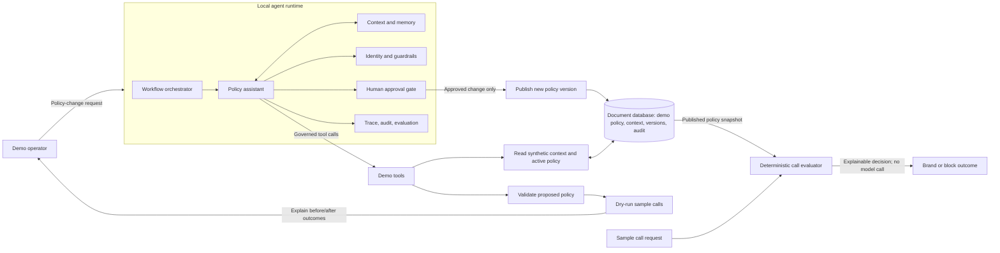

# Telecom Call Policy Lifecycle Demo (Atlas Agent Engine)

A self-contained demonstration of a **fictional** business-call policy
lifecycle, built on the Atlas Agent Engine local development stack.

> **Everything in this demo is fictional.** The enterprise, carriers, brands,
> rules, phone numbers, and policies are synthetic fixtures invented for this
> walkthrough. Nothing here represents any real organization's actual
> policies, data model, architecture implementation, or security controls.

## The story (5–7 minute walkthrough)

The scenario is a proposed business-calling service: calls originating from an
enterprise are checked against synthetic reference data and service
relationships. Recognized, authorized calls may be delivered with the business
name/logo; calls not recognized as authorized may be blocked.

This demo shows the *agent-authoring* half of that story — the part that
benefits from agentic flexibility — while keeping the live call decision
deterministic:

```
Operator request (playground UI, http://localhost:3000)
  1. Agent retrieves synthetic context via explicit tools
     (enterprise profile, carrier relationships, brand metadata,
      active policy, sample calls)
  2. Agent drafts a structured policy change (constrained demo DSL)
  3. Validation: schema, referential integrity, permitted status transitions
  4. Dry run: proposed vs. active policy over sample calls (before/after table)
  5. Human approval: execution SUSPENDS (Agent Engine interrupt) until a
     human approves or denies
  6. Only after approval: a new versioned policy record is published,
     with a full audit trail
  7. Deterministic call evaluation (no LLM) against the active policy snapshot
```

**Where the agent runtime fits vs. the policy evaluator.** The agent runtime
provides the agent scaffold, tool sandboxing, LLM connection, and native
human-in-the-loop suspend/resume. The *call evaluation* itself is plain
deterministic Python (`evaluator.py`); most live call decisions should remain
deterministic over preprocessed/published policy data and never invoke an LLM.
This demo is not a claim that the document database is a complete rules
engine, nor that the agent runtime replaces an existing orchestration
framework — it illustrates how agents can help *author and govern* policy for
such a system.

## Architecture



Implemented in this demo: the policy assistant, governed demo tools, DSL
validation, dry-run comparison, the human approval gate (native
suspend/resume), versioned publishing, the audit trail, and the deterministic
evaluator. Trace/evaluation surfaces come from the runtime's local dev stack;
no dedicated evaluation harness is implemented here.

## Prerequisites

- Docker Desktop running (for `agentengine dev up`)
- Agent Engine CLI (`agentengine`) on your `PATH`
- An LLM API key for the configured LLM client (set as `LLM_API_KEY`)
- Optional: an existing database cluster provisioned by
  [`../atlas-cluster-provisioning/`](../atlas-cluster-provisioning/) (this demo
  never creates, alters, or deletes a cluster)

## Setup

```bash
cd agents/call-policy-agent
cp env.example .env
# Edit .env:
#   LLM_API_KEY=<your key>
#   MONGODB_URI=          # leave EMPTY for mock mode, or point at an
#                         # existing cluster from atlas-cluster-provisioning
```

## Run

```bash
agentengine dev up
```

Then open the Playground UI at <http://localhost:3000>. Stop with
`agentengine dev stop`.

> **Troubleshooting:** `agentengine dev up` pulls runtime container images
> from the runtime's container registry. If the registry denies the pull, run
> `agentengine auth login` first (an authenticated session is required to
> fetch those images). Everything else in this demo — tests and deterministic
> call evaluation — runs without the stack.

**Modes**

- **Mock mode (default when `MONGODB_URI` is empty):** the demo store is
  in-memory; the log prints a clear `MOCK MODE` banner. Nothing is persisted.
  Deterministic call evaluation from the CLI works offline against the seeded
  baseline fixture policy.
- **MongoDB mode:** set `MONGODB_URI` to an existing cluster. The demo uses a
  dedicated database (`call_policy_demo` by default) and touches **only** its
  own collections (`policy_drafts`, `policy_versions`, `policy_approvals`,
  `policy_audit`, `demo_context`). Note: `agentengine dev` supplies its own
  local MongoDB URI; set `MONGODB_URI` explicitly in the environment when you
  want the app data on your cluster.

## Example prompts (playground)

1. *"Show me the current call policy for demo_enterprise_001 and the context
   behind it."* → agent calls `get_active_policy`, `get_enterprise_profile`,
   `list_carrier_relationships`, `get_brand_metadata`, and cites sources.
2. *"We started servicing GB-originated traffic on demo_carrier_002. Draft a
   rule that delivers those calls without a brand, and block anything else
   unmatched."* → agent drafts DSL rules, submits via `submit_policy_draft`
   (validation).
3. *"What would change?"* → `simulate_policy` prints a before/after table for
   the four sample calls.
4. *"Submit it for approval."* → `request_policy_approval` suspends the agent.
   Approve/deny in the playground's review prompt (the native interrupt).
5. After approving: *"Publish it."* → `publish_policy` records version 2 and
   supersedes version 1. *"Show the audit trail."* → `show_audit_trail`.
6. *"Evaluate a call from +441234567890 on demo_carrier_002 from GB"* →
   `evaluate_call_tool` returns the deterministic decision, matched rule, and
   policy version (no LLM involved).

Expected guardrail behavior to show on camera:

- A draft with an unknown brand or enterprise, or an invalid field, fails
  validation with named errors.
- Attempting to publish without approval returns an explicit refusal
  (`no recorded human approval`).
- A denied approval marks the draft rejected; it can never be published.

## Deterministic call evaluation (no LLM)

```bash
# Mock mode, seeded baseline policy:
PYTHONPATH=src python -m agent_call_policy_agent.evaluate_cli

# One ad-hoc number against the active policy on an existing cluster:
MONGODB_URI=... PYTHONPATH=src python -m agent_call_policy_agent.evaluate_cli \
  --from-number +15551230001
```

## Reset / re-seed

Synthetic fixtures (including baseline policy version 1) re-seed automatically
when the store is empty. To wipe demo data in MongoDB and start over:

```bash
PYTHONPATH=src python -m agent_call_policy_agent.reset_demo --yes
```

This drops **only** the demo collections listed above. In mock mode nothing is
persisted, so there is nothing to reset.

## Tests

```bash
PYTHONPATH=src python -m pytest tests -q
```

Covers: DSL validation (unknown actions/brands/enterprises, prefixes),
permitted-transition matrix, approval gating (publish refuses without an
approved decision; denied drafts are dead ends), versioning/supersede
behavior, audit-trail ordering, and deterministic evaluation/dry-run diffs.

## What is mocked / honest limitations

- **Synthetic data everywhere** — fixtures in
  `src/agent_call_policy_agent/fixtures.py` are marked `demo: True` with
  fictional names; outputs repeat the caveat.
- **The DSL is a toy** — a constrained JSON rule structure with local
  validation, not a production rules engine and not any real organization's
  model.
- **Human approval** uses the runtime's native `interrupt()` suspend/resume
  (not an approximation) in the dev environment; there is no IAM-grade
  approval workflow around it.
- **No deployment** — the demo is local (`agentengine dev`). It never
  provisions clusters, never makes external calls beyond the configured LLM
  egress, and never touches non-demo data.
- Latency or coverage ambitions discussed in any particular engagement are
  rough POC ambitions, not commitments, and are out of scope for this code.
