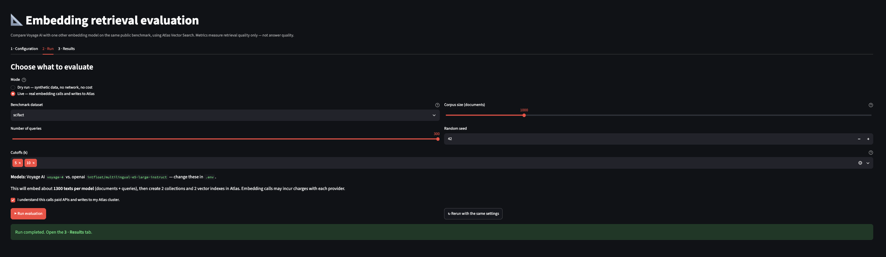
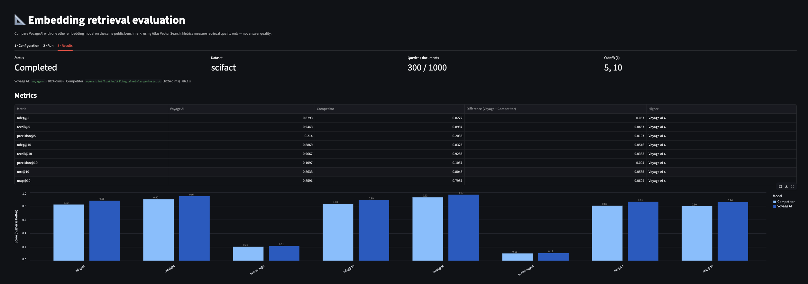
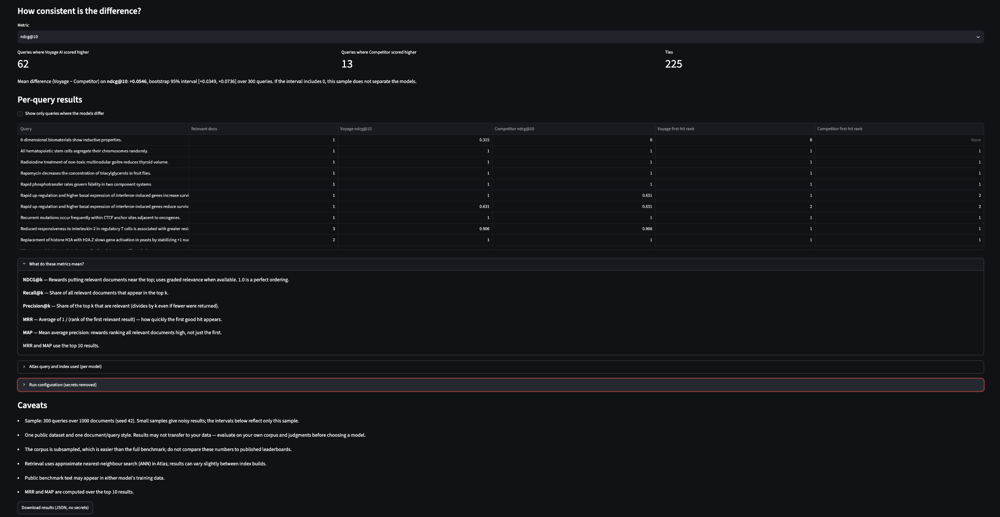
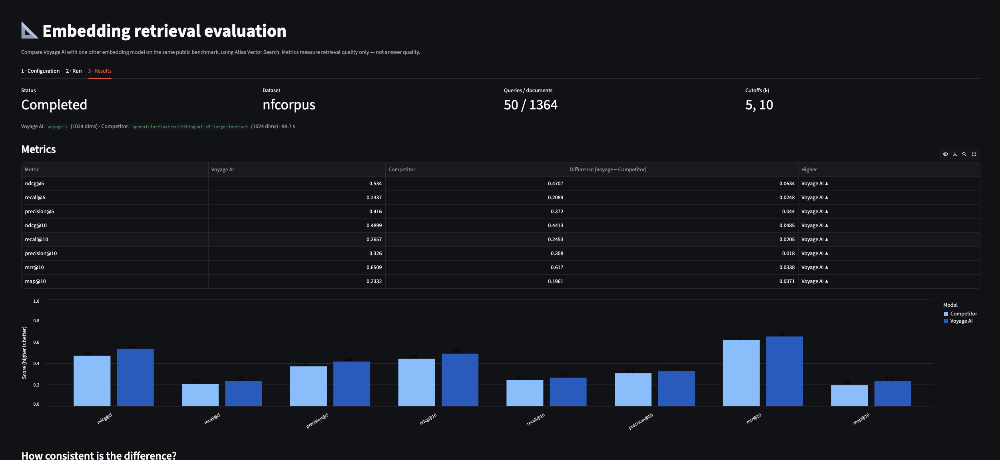

# Voyage AI Embedding Evaluation

A guided Streamlit app that compares **Voyage AI** embeddings with **one competing embedding model** (your choice) on a small public retrieval benchmark, using **Atlas Vector Search**. It measures *retrieval quality only* — not LLM answer quality.

Both models get exactly the same sampled documents, document text, queries, relevance judgments (qrels), retrieval depth, and `$vectorSearch` settings. Only the embedding model — and therefore its collection, vectors and index dimensions — differs.

> Approach adapted from the public [retrieval_eval_demo](https://github.com/hweller1/retrieval_eval_demo) lab: keep `queries`, `qrels` and each model's ranked document IDs as separate things, and report standard IR metrics. This demo covers only the two-embedding comparison (no BM25/hybrid, no LLM-drafted judgments).

## What you get

| Path | Role |
|---|---|
| `app.py` | Streamlit GUI: **1 Configuration → 2 Run → 3 Results** |
| `lib/config.py` | `.env` loading, validation, secret-free status and config views |
| `lib/providers.py` | One adapter per provider (Voyage, OpenAI, Cohere, Gemini): real request shapes, document-vs-query modes, batching, retry/backoff |
| `lib/dataset.py` | BEIR download + seeded sampling |
| `lib/store.py` | Atlas collection/index setup and `$vectorSearch` (plus an in-memory twin for the dry run) |
| `lib/pipeline.py` | Sample → embed → index → retrieve → score |
| `lib/metrics.py` | NDCG, Recall, Precision, MRR, MAP, and a paired comparison |
| `lib/cache.py`, `lib/mock.py` | Optional embedding cache; offline fake provider and synthetic data |
| `scripts/cleanup.py` | Drop the collections/indexes the demo created |
| `tests/` | Offline unit tests and a GUI smoke test |

## Prerequisites

- Python 3.10+ (tested on 3.13).
- An **Atlas cluster** with Vector Search (M0 works), a database user with `readWrite` on the demo database, and your IP on the Atlas access list. To provision one, see [`../atlas-cluster-provisioning/`](../atlas-cluster-provisioning/).
- A **Voyage AI key** and a **competitor key** (below). The Atlas connection string is a different credential from both.

## Credential setup

```bash
cd voyageai-embedding-eval
cp .env.example .env      # .env is git-ignored; never commit it
# edit .env and fill in the placeholders
```

| Variable | Purpose |
|---|---|
| `MONGODB_URI` | Atlas `mongodb+srv://…` connection string |
| `VOYAGE_API_KEY`, `VOYAGE_BASE_URL`, `VOYAGE_MODEL` | Voyage credential, endpoint and model (default `voyage-4`) |
| `COMPETITOR_EMBEDDING_PROVIDER` | `openai`, `cohere` or `gemini` (default `openai`, used with a base URL for DeepInfra) |
| `COMPETITOR_EMBEDDING_MODEL` | Any model that provider's embedding API accepts (default `intfloat/multilingual-e5-large-instruct`) |
| `COMPETITOR_API_KEY` | Generic key variable for whichever provider you pick |
| `COMPETITOR_BASE_URL` | Default `https://api.deepinfra.com/v1/openai`; blank uses the provider's own endpoint |
| `*_OUTPUT_DIMENSION` | Optional — provider-documented dimension option |
| `COMPETITOR_DOCUMENT_PREFIX`, `COMPETITOR_QUERY_PREFIX` | Text prepended to documents / queries. The example sets the E5 query instruction; leave blank for OpenAI, Cohere and Gemini |
| `DB_NAME`, `COLLECTION_PREFIX`, `EVAL_*` | Namespace and run defaults |

**Which Voyage key?** The default `VOYAGE_BASE_URL=https://ai.mongodb.com/v1` is the Atlas-hosted Voyage endpoint and takes a *model API key* created in the Atlas UI (AI Models). A key issued directly by Voyage AI works only with `https://api.voyageai.com/v1` — set `VOYAGE_BASE_URL` accordingly. The two are not interchangeable. (Per MongoDB's Embedding and Reranking API docs; the Atlas-hosted API is in preview, so confirm availability for your project.)

**Competitors.** The adapters use each provider's real API: OpenAI `POST /v1/embeddings`; Cohere `POST /v2/embed` with `search_document`/`search_query`; Gemini `batchEmbedContents` with `RETRIEVAL_DOCUMENT`/`RETRIEVAL_QUERY`. Any model name the provider accepts works. **Open-weights models on a hosted service** (e.g. `intfloat/multilingual-e5-large-instruct` on DeepInfra) use `openai` with `COMPETITOR_BASE_URL=https://api.deepinfra.com/v1/openai` and the query instruction prefix shown in `.env.example`. Models with their own API shape need a new small adapter in `lib/providers.py`. OpenAI-compatible servers work via `COMPETITOR_BASE_URL`, but only if they need no special document/query prefixes.

Dimensions are never truncated or reshaped by this code. If you set `*_OUTPUT_DIMENSION`, it is sent using the provider's own parameter and the response is verified; a mismatch is an error. Gemini vectors at less than full size are not unit-length; cosine similarity is length-independent, so this does not affect ranking here.

**Default competitor in `.env.example`:** [`intfloat/multilingual-e5-large-instruct`](https://huggingface.co/intfloat/multilingual-e5-large-instruct) (1024 dims) served by DeepInfra's OpenAI-compatible endpoint, `https://api.deepinfra.com/v1/openai`, with your DeepInfra key in `COMPETITOR_API_KEY`. Per the model card, E5-instruct queries get an `Instruct: <task>\nQuery: <query>` prefix and documents stay plain, which is what the example prefix does. Without the query prefix E5 is handicapped and the comparison is unfair. Switch to OpenAI, Cohere or Gemini by changing the provider, model, key and (for those) clearing the base URL and prefix.

## Install and run

```bash
python -m venv .venv && source .venv/bin/activate
pip install -r requirements.txt
streamlit run app.py
```

Opening the app makes **no** network calls. It starts in **dry-run** mode (synthetic data, fake embeddings, no database), so you can see the whole workflow with no credentials.

## GUI workflow

1. **Configuration** — shows which settings are present (never their values), the Atlas requirements, and the secret-free run configuration.
2. **Run** — pick dry run or live, dataset, number of queries, corpus size, seed and k cutoffs. Live runs require you to tick a confirmation (paid API calls, Atlas writes). **Rerun with the same settings** repeats the last run exactly.
3. **Results** — metrics table (with a text marker for the higher score, not colour alone), grouped bar chart with value labels, per-query win/loss/tie counts with a bootstrap interval, per-query table, the exact index and `$vectorSearch` pipeline used, caveats, and a JSON download without secrets.

## Example: what you'll see

These screenshots come from real live runs of this demo: `voyage-4` (Atlas-hosted endpoint) against `intfloat/multilingual-e5-large-instruct` on DeepInfra, 1024-dimensional vectors for both, cutoffs k = 5 and 10, seed 42.

**Inputs — the Run tab.** Pick the mode, dataset, number of queries, corpus size, seed and cutoffs. The model names come from `.env`. Live mode requires ticking the confirmation box before anything is called or written, and **Rerun with the same settings** repeats the previous run.



**Outputs — the Results tab.** Run status, dataset, query and document counts, cutoffs and the two models, then a metrics table with a text marker for the higher score (not colour alone) and a grouped bar chart with value labels.



**How consistent is the difference, and per-query results.** Win / loss / tie counts and a seeded bootstrap interval for the chosen metric, a per-query table with the rank of the first relevant hit for each model, the metric definitions, the exact index and `$vectorSearch` pipeline used, the secret-free run configuration, and the caveats.



*Layout only:* this earlier 50-query NFCorpus run was made **before** the E5 query instruction was configured, so E5 was handicapped. Use it to see the layout, not the numbers.



### Example results (300 queries, same settings as above, E5 with its query instruction)

| Dataset | Corpus | NDCG@10 Voyage / E5 | Difference | 95% bootstrap interval |
|---|---|---|---|---|
| SciFact | 1,000 docs | 0.887 / 0.832 | +0.055 | [+0.035, +0.074] |
| NFCorpus | 3,055 docs | 0.427 / 0.377 | +0.050 | [+0.033, +0.067] |

On both datasets `voyage-4` scored higher on all eight metrics, and each interval excluded zero. Read this as one setup on two public, subsampled benchmarks, not a general ranking: the interval only reflects sampling of these queries, the SciFact run used the generic (non-claim) E5 instruction, and results on your own data may differ. See [Limitations](#limitations).

## What a live run does

1. Downloads the BEIR zip into `data/` (git-ignored) and samples queries/documents with the seed. Relevant documents of the sampled queries are always kept; the rest of the corpus is a seeded random subset.
2. For each model: embeds a probe text to learn the vector dimension, creates its own collection and a `vectorSearch` index with that `numDimensions` (`cosine`), embeds missing documents in `document` mode and inserts them, and waits for the index to be queryable.
3. Embeds queries in `query` mode, runs `$vectorSearch` (`limit` = largest k, `numCandidates` = max(20×limit, 100)), and scores the ranked IDs against the qrels.

Collection names are `<COLLECTION_PREFIX>_<dataset>_<voyage|competitor>_<model>_<hash of sample+model settings>`. Re-running identical settings reuses the collections and skips re-embedding documents already stored.

The embedding cache (`.cache/`, `EVAL_USE_CACHE`) is keyed by SHA-256 of provider, endpoint, model, dimension, input mode and exact text, so entries cannot cross models or modes. Vectors are stored as float32. Delete `.cache/` any time.

## Dataset

Default: BEIR **SciFact** (scientific claims → abstracts; small, good for a first run); **NFCorpus** is also available. Both download on demand from the public BEIR host. Datasets keep their own licenses (SciFact is CC BY-NC 2.0, non-commercial) — check the dataset card before using beyond a demo. Data is public benchmark text only.

## Metrics

Computed per query and averaged, at the k values you select (default 5 and 10). Retrieval depth is the largest k.

- **NDCG@k** — graded gain, log₂ discount, divided by the ideal ordering.
- **Recall@k** — relevant found in top k ÷ all relevant.
- **Precision@k** — relevant in top k ÷ k.
- **MRR@depth** — mean of 1 ÷ rank of the first relevant result.
- **MAP@depth** — mean average precision; divides by *all* relevant documents.

Duplicate IDs count once; queries with no relevant document are skipped and reported; a query missing from a run scores zero. See `lib/metrics.py` for exact definitions.

## Limitations

- One public dataset, a subsampled corpus and (by default) 50 queries: results are noisy and do not generalise to your data. The bootstrap interval reflects only the sampled queries. Evaluate on your own corpus and judgments before choosing a model.
- Subsampling makes the task easier than the full benchmark; don't compare to published leaderboards.
- Atlas uses approximate nearest-neighbour search, so small run-to-run variation is possible.
- Public benchmark text may appear in a model's training data.
- Providers truncate over-long inputs differently (the adapters request end-truncation); SciFact/NFCorpus texts are short, but other data may not be.
- Voyage and the competitor may have different costs and latency; this demo does not compare either.

## Tests

```bash
pip install -r requirements-dev.txt
python -m pytest -q
```

All tests run offline: metrics (hand-computed cases and edge cases), configuration validation and secret redaction, provider adapters against mocked HTTP responses, sampling, store behaviour with a mocked Atlas client, a dry-run pipeline, and a Streamlit `AppTest` smoke test. **They do not exercise a real Atlas cluster or provider API.**

## Cleanup

```bash
python scripts/cleanup.py          # list the demo's collections
python scripts/cleanup.py --yes    # drop them (this also removes their search indexes)
```

Only `<COLLECTION_PREFIX>_*` collections in `DB_NAME` are touched. M0 allows 3 search indexes in total and each run configuration uses 2 — clean up before changing dataset size, seed or models. Remove `.cache/` and `data/` locally if wanted.

## Troubleshooting

- *authentication failed (HTTP 401/403)* — wrong key type for the endpoint (see "Which Voyage key?"), or no access to that model.
- *Could not reach the Atlas cluster* — add your IP to the access list.
- *Index … numDimensions=X but this model produces Y* — an older run used a different dimension; run the cleanup script.
- *index was not queryable* — builds can take a minute or two; rerun to continue.
